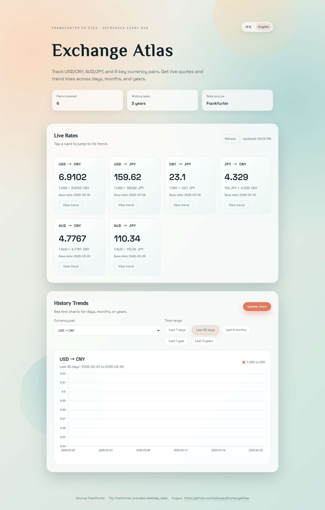

# Exchange Atlas

<div align="center">
  <p><strong>一个把我对汇率、信息设计和轻量前端偏好落成页面的小项目。</strong></p>
  <p>A bilingual exchange-rate dashboard that reflects my preference for useful tools, calm visuals, and lightweight front-end engineering.</p>

  <p>
    <a href="https://exchange.bojiang.org">
      
    </a>
    
    
    
    
  </p>

  <p>
    <a href="https://exchange.bojiang.org"><strong>在线访问</strong></a>
    ·
    <a href="https://www.frankfurter.app"><strong>数据源</strong></a>
    ·
    <a href="./assets/preview-home.png"><strong>查看预览图</strong></a>
  </p>
</div>

<p align="center">
  <a href="https://exchange.bojiang.org">
    
  </a>
</p>

## 项目简介

Exchange Atlas 是一个轻量的汇率观测站，围绕几组我自己会长期关注的币种对，提供实时汇率和历史走势。它不是为了堆砌功能，也不是为了做一个“像作品集一样的壳子”，而是把我对信息组织、视觉节奏、交互密度和部署方式的偏好，做成一个真正能打开、能用、能持续维护的小网页。

如果想了解我平时会关注什么、倾向怎样处理前端复杂度、以及我对“工具感”和“可读性”的取舍，这个项目比一段自我介绍更直接。

## 在线访问

- 地址: [https://exchange.bojiang.org](https://exchange.bojiang.org)
- 访问方式: 直接打开即可使用，无需登录、无需安装、无需构建
- 项目状态: 已上线的静态站点，而不是只停留在本地截图里的 demo

## 我为什么做这个

- 我对汇率、跨币种信息和长期趋势这类内容本身就有兴趣，做成页面比放在零散标签页里更自然。
- 我偏好把常看的数据做成低摩擦工具，打开就有结果，不需要复杂操作。
- 我喜欢信息密度清晰、层级分明、视觉克制但不单调的界面。
- 我也倾向用更轻的技术方案解决明确问题，而不是先上框架再找需求。

## 核心功能

- 实时汇率卡片: 覆盖 `USD/CNY`、`USD/JPY`、`CNY/JPY`、`JPY/CNY`、`AUD/CNY`、`AUD/JPY` 六组币种对，并每 `60` 秒自动刷新。
- 历史趋势图表: 支持 `7 天 / 30 天 / 6 个月 / 1 年 / 3 年` 五档时间范围，快速查看中短期和长期走势。
- 双语界面: 提供中文与 English 切换，并将语言偏好写入 `localStorage`。
- 响应式布局: 桌面端和移动端都能正常阅读和操作。
- 轻部署结构: 纯静态前端，无需构建流程，便于长期维护和快速部署。

## 这个项目体现了我的哪些偏好

- 信息表达: 我更在意信息是否被组织得清楚，而不只是把数据堆上去。
- 工具气质: 我喜欢能长期打开、真正有使用场景的页面，而不是一次性的展示页。
- 技术取舍: 用 `HTML + CSS + Vanilla JavaScript` 完成模块拆分、状态管理、异步请求和交互联动，保持依赖克制。
- 视觉判断: 我不太喜欢默认模板感，所以页面用了更明确的字体组合、背景氛围、卡片层次和留白节奏。
- 可读性优先: 图表、按钮、状态提示、语言切换这些部分都优先服务阅读和操作，而不是为了“显得复杂”。

## 技术亮点

- 基于 `Frankfurter API` 拉取实时汇率与历史区间数据
- 使用 `Chart.js` 绘制折线图，并加入 crosshair 交互增强图表读数体验
- 通过自定义 `i18n` 字典完成中英文切换
- 使用 `localStorage` 记录语言偏好
- 无构建依赖，直接以静态资源形式部署

## 适合什么场景

- 快速查看主流币种对的最新价格和阶段走势
- 作为一个长期维护的个人小工具，而不是一次性的实验页面
- 作为理解我个人兴趣、产品取向和前端实现方式的一个切片
- 作为静态站点、Vanilla JavaScript、Chart.js、前端国际化的轻量参考

## 技术栈

| 模块 | 方案 |
| --- | --- |
| 前端 | `HTML5` + `CSS3` + `Vanilla JavaScript` |
| 图表 | `Chart.js` |
| 数据源 | `Frankfurter API` |
| 国际化 | 自定义 `i18n` 字典 + `localStorage` |
| 部署形态 | 静态站点 |
| 线上地址 | `https://exchange.bojiang.org` |

## 本地运行

由于浏览器对本地文件协议下的 `fetch` 有限制，建议通过静态服务器启动项目。

```bash
python -m http.server 8000
```

然后访问 [http://localhost:8000](http://localhost:8000)。

## 项目结构

```text
.
├─ index.html
├─ styles.css
├─ app.js
├─ app.core.js
├─ app.i18n.js
├─ app.rates.js
├─ app.chart.js
├─ app.controls.js
└─ assets/
   └─ preview-home.png
```

- `index.html`: 页面结构与主要信息区域
- `styles.css`: 渐变背景、卡片、按钮、图表容器和响应式样式
- `app.core.js`: 全局状态、公共工具、币种对与时间范围配置
- `app.i18n.js`: 中英文文案与语言切换逻辑
- `app.rates.js`: 实时汇率卡片渲染与刷新逻辑
- `app.chart.js`: 历史汇率请求与图表绘制
- `app.controls.js`: 币种、时间范围和交互事件绑定
- `app.js`: 应用初始化入口

## 数据来源

- 汇率数据来自 [Frankfurter](https://www.frankfurter.app)
- 历史数据以工作日汇率为准，非交易日可能不会返回新的采样点

## 总结

对我来说，这不是一个为了“展示能力”而被刻意包装出来的项目，而是把个人兴趣、审美取向和技术判断自然落成网页的结果。它体量不大，但足够完整，也足够诚实。
