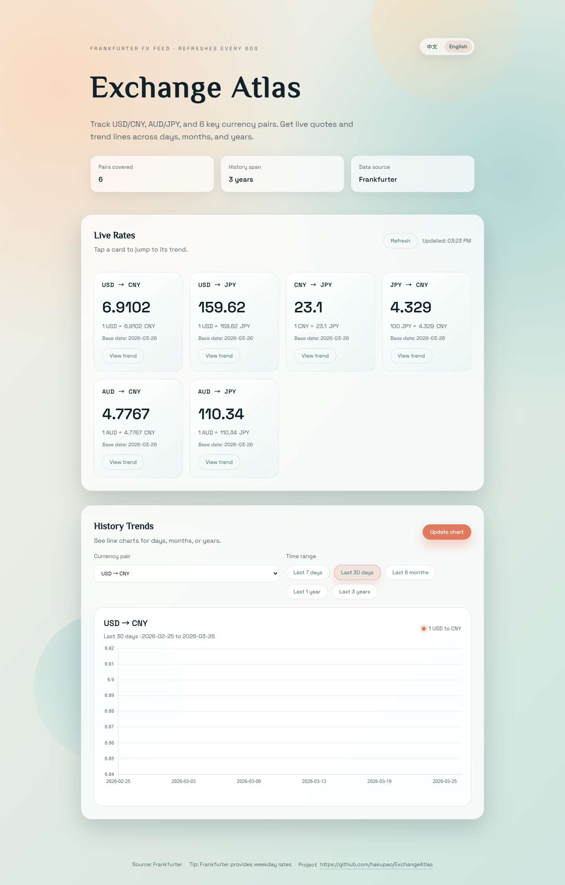

[English](README.md) | [中文](README_CN.md)

<div align="center">
  
</div>

<div align="center">

[](https://developer.mozilla.org/en-US/docs/Web/JavaScript)
[](https://www.chartjs.org/)
[](https://tc39.es/ecma262/)
[](https://www.frankfurter.app/)
[](https://exchange.bojiang.org

<div align="center">
  
</div>
)
[](https://exchange.bojiang.org)

**实时监控6大货币对 · 精美交互图表 · 免费隐私API**

</div>

---

## 项目背景

我叫**伯江**（Bojiang），在日本工作的外籍人士。我在多种货币间工作——日元（工作）、人民币（家人）、美元（国际项目）——需要一眼看清汇率。

现有汇率应用？堆满广告、收集数据、臃肿不堪。所以我建立了 **ExchangeAtlas**——一个清爽、轻量的看板，监控我最关心的六个货币对。

---

## 🎯 主要功能

### 监控六大货币对

| 货币对 | 使用场景 | 实时更新 |
|--------|---------|---------|
| **USD/CNY** | 美元 ↔ 人民币 | ✅ 实时 |
| **USD/JPY** | 日元 ↔ 美元 | ✅ 实时 |
| **CNY/JPY** | 人民币 ↔ 日元 | ✅ 实时 |
| **JPY/CNY** | 日元 ↔ 人民币（反向） | ✅ 实时 |
| **AUD/CNY** | 澳元 ↔ 人民币 | ✅ 实时 |
| **AUD/JPY** | 澳元 ↔ 日元 | ✅ 实时 |

### 实时更新

- 📊 **即时图表**：交互式Chart.js可视化
- 🔄 **自动刷新**：可配置更新间隔（默认5分钟）
- 📈 **7天历史**：追踪趋势和历史数据
- 🌍 **无广告无追踪**：隐私优先架构
- 🚀 **闪电般快速**：轻量级、纯原生JavaScript

### 智能功能

| 功能 | 详情 |
|------|------|
| 💱 **快速兑换** | 货币对间即时转换 |
| 📉 **价格提醒** | 设置阈值并获取通知（本地存储） |
| 🕐 **历史趋势** | 查看7天价格变化 |
| 🌓 **深色/浅色** | 护眼界面，随时切换 |
| 🔀 **对快速切换** | 一键聚焦任何货币对 |

---

## 🌐 在线演示

访问 **[exchange.bojiang.org](https://exchange.bojiang.org)** 立即使用。

---

## 🚀 快速开始

### 前置条件
- 现代浏览器（Chrome、Firefox、Safari、Edge）
- 网络连接（用于API调用）
- 无需后端！

### 安装

```bash
# 克隆仓库
git clone https://github.com/hakupao/ExchangeAtlas.git
cd ExchangeAtlas

# 在浏览器中打开
open index.html        # macOS
xdg-open index.html    # Linux
start index.html       # Windows
```

---

## 📂 项目结构

```
ExchangeAtlas/
├── index.html          # 主文件
├── styles.css          # 布局和主题
├── app.core.js         # 核心应用逻辑
├── app.rates.js        # 汇率获取
├── app.chart.js        # Chart.js包装器
├── app.controls.js     # UI控制和事件
├── app.i18n.js         # 国际化 (中英)
└── assets/
    ├── icons/          # 货币对图标
    └── fonts/          # 系统字体
```

### 模块说明

| 文件 | 用途 |
|------|------|
| **app.core.js** | 状态管理、数据模型 |
| **app.rates.js** | Frankfurter API集成 |
| **app.chart.js** | 图表渲染和更新 |
| **app.controls.js** | 事件处理、UI交互 |
| **app.i18n.js** | 英文/中文翻译 |

---

## 🔌 API集成

### Frankfurter API

使用免费、开源的 **[Frankfurter](https://www.frankfurter.app/)** 服务：

```javascript
// 示例API调用
const response = await fetch(
  'https://api.frankfurter.app/latest?from=USD&to=JPY'
);
const data = await response.json();
console.log(data.rates.JPY);  // 149.35 (示例)
```

**为什么选Frankfurter？**
- ✅ 无需认证
- ✅ 免费、有合理速率限制
- ✅ 尊重隐私（无分析跟踪）
- ✅ 永远可用的免费服务
- ✅ 基于欧洲中央银行数据

### 自动刷新

应用每5分钟获取一次汇率（可配置）：

```javascript
// 在 app.core.js 中
const REFRESH_INTERVAL = 5 * 60 * 1000;  // 5分钟
setInterval(updateRates, REFRESH_INTERVAL);
```

---

## 🎨 用户界面

### 仪表板布局

```
┌─────────────────────────────────────────┐
│  ExchangeAtlas  [🌓 主题]  [🇨🇳 语言]    │
├─────────────────────────────────────────┤
│  货币对选择: [USD/JPY ▼]                 │
├─────────────────────────────────────────┤
│  当前汇率: 149.35  [▲ 0.23%] 24h        │
├─────────────────────────────────────────┤
│  [图表: 7天趋势曲线]                     │
├─────────────────────────────────────────┤
│  快速兑换:  [100] USD = 14,935 JPY     │
├─────────────────────────────────────────┤
│  [货币对按钮: USD/CNY  USD/JPY ...]     │
└─────────────────────────────────────────┘
```

### 响应式设计

- **桌面**：完整仪表板，大图表
- **平板**：堆叠货币对，触摸友好按钮
- **手机**：竖向布局，单手操作优化

---

## 🌍 国际化支持

完整支持以下语言：

| 语言 | 覆盖 |
|------|------|
| 🇬🇧 **English** | 100% - 所有标签、帮助文本 |
| 🇨🇳 **中文** (简体) | 100% - 完整中文界面 |

在右上角切换，或在 `app.i18n.js` 中修改默认值：

```javascript
let currentLanguage = 'zh';  // 'en' 或 'zh'
```

---

## 💡 真实应用案例

### 案例1：外籍人士薪资规划

**场景：** 自由职业者赚USD，在日本生活

```
每日检查：
1. 打开ExchangeAtlas
2. 查看USD/JPY汇率
3. 实时计算预期日元薪资
4. 规划月度支出
```

### 案例2：投资机会

**场景：** 监控AUD/CNY以寻求套利机会

```
设置价格提醒：
- AUD/CNY > 5.2时提醒
- AUD/CNY < 4.8时提醒
- 做出交易决策
```

### 案例3：旅行预算

**场景：** 规划多国旅行的开支

```
1. 用本币输入旅行预算
2. 在货币对间切换
3. 看到实时换算金额
4. 按国家规划支出
```

---

## 🔧 技术栈

| 类别 | 技术 |
|------|------|
| 📄 **标记** | HTML5语义结构 |
| 🎨 **样式** | CSS3 (flexbox、grid、动画) |
| ⚙️ **逻辑** | 原生JavaScript ES2023 |
| 📊 **图表** | Chart.js 3.x |
| 🌐 **API** | Frankfurter (免费、无认证) |
| 🌍 **托管** | 静态文件服务 |

---

## 📊 数据流

```
┌─────────────────┐
│  Frankfurter    │ (免费汇率API)
│    API          │
└────────┬────────┘
         │ (JSON响应)
         ▼
┌─────────────────┐
│  app.rates.js   │ (解析和缓存)
└────────┬────────┘
         │ (汇率对象)
         ▼
┌─────────────────┐
│  app.core.js    │ (状态管理)
└────────┬────────┘
         │ (更新状态)
         ▼
┌─────────────────┐
│  app.chart.js   │ (可视化)
│  app.controls.js│ (显示和交互)
└─────────────────┘
```

---

## ⚙️ 配置

### 自定义刷新间隔

在 `app.core.js` 中：

```javascript
// 从5分钟改为10分钟
const REFRESH_INTERVAL = 10 * 60 * 1000;
```

### 添加更多货币对

在 `app.core.js` 中，加入货币对数组：

```javascript
const PAIRS = [
  // 现有货币对...
  { from: 'EUR', to: 'GBP', label: 'EUR/GBP' }
];
```

### 修改默认主题

在 `styles.css` 中：

```css
:root {
  --color-bg: #ffffff;
  --color-text: #000000;
  --color-chart: #4F46E5;
  /* 按需自定义 */
}
```

---

## 🚨 已知限制

| 限制 | 原因 | 解决方案 |
|------|------|--------|
| 历史数据仅7天 | API限制 | 使用外部服务做长期分析 |
| 更新间隔≥5分钟 | API速率限制 | 按需调整，勿超100次/天 |
| JPY/CNY是计算值 | 不是直接货币对 | 汇率 = 1 / (CNY/JPY) |
| 无推送通知 | 隐私优先 | 仅使用本地存储提醒 |

---

## 🤝 贡献

发现汇率显示bug？有新货币对的想法？

1. Fork本仓库
2. 创建功能分支 (`git checkout -b feature/new-pair`)
3. 提交更改
4. 推送并开启Pull Request

---

## 📝 许可证

MIT许可证 - 自由使用、修改。

---

## 🙋 常见问题

**Q: 我的数据安全吗？**
A: 完全安全——无后端、无数据库、无追踪。所有操作在浏览器本地进行。

**Q: 能下载历史数据吗？**
A: 目前应用内限于7天。Frankfurter API的直接调用提供更长历史。

**Q: 为什么不用实时WebSocket连接？**
A: Frankfurter API用REST加5分钟缓存。对日常使用足够；高频交易则过度。

**Q: 能离线使用吗？**
A: 不行——需要网络获取实时汇率。浏览器缓存有帮助，但实时数据需要连接。

---

## 📞 联系方式

- 🌐 网站: [bojiang.org](https://bojiang.org)
- 📧 邮箱: hi@bojiang.org
- 🐙 GitHub: [@hakupao](https://github.com/hakupao)
- 🔗 在线: [exchange.bojiang.org](https://exchange.bojiang.org)

---

<div align="center">

**监控全球汇率流动，做出明智决策 💱**

在日本横滨用❤️制作

</div>
